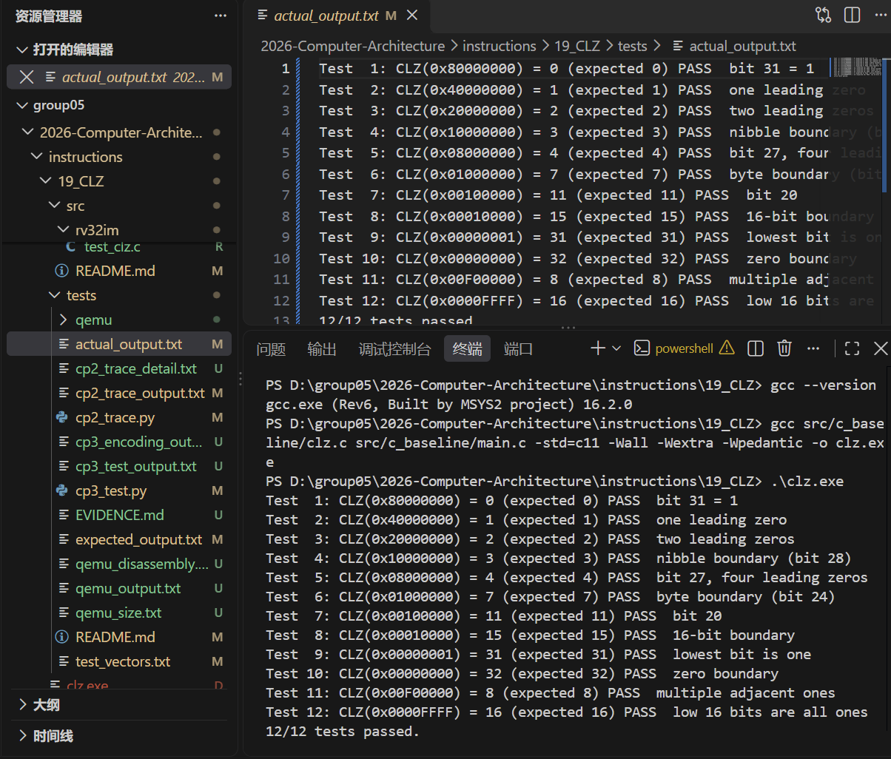

# CP1：C baseline

## 1. 本次目標

以 C 實作 CLZ，建立 12 組測試向量（含全零邊界），並確認預期輸出與實際
執行結果一致。

## 2. 設計內容

### 2.1 語意

CLZ（Count Leading Zeros）接收一個 32-bit `uint32_t`，回傳從 bit 31
開始連續的 0 的個數。若輸入為 `0x00000000`，依規格回傳 `32`。

```c
uint32_t clz(uint32_t x);
```

### 2.2 演算法

本實作依序檢查 16、8、4、2、1 位元區段：

1. 若高 16 位元全為 0，計數加 16，輸入左移 16 位。
2. 若接下來 8 位元全為 0，計數加 8，輸入左移 8 位。
3. 依序檢查 4、2、1 位元。
4. 全部為 0 時直接回傳 32。

五個階段固定，時間複雜度為 `O(1)`，不需要逐位從 31 掃描到 0。

### 2.3 測試設計

測試資料在 [`../tests/test_vectors.txt`](../tests/test_vectors.txt)，
預期輸出在 [`../tests/expected_output.txt`](../tests/expected_output.txt)，
實際輸出在 [`../tests/actual_output.txt`](../tests/actual_output.txt)。

| 測試 | 輸入 | 預期 CLZ | 說明 |
|---:|---|---:|---|
| 1 | `0x80000000` | 0 | bit 31 = 1 |
| 2 | `0x40000000` | 1 | 1 個前導零 |
| 3 | `0x20000000` | 2 | 2 個前導零 |
| 4 | `0x10000000` | 3 | nibble 邊界（bit 28） |
| 5 | `0x08000000` | 4 | bit 27，4 個前導零 |
| 6 | `0x01000000` | 7 | byte 邊界（bit 24） |
| 7 | `0x00100000` | 11 | bit 20 |
| 8 | `0x00010000` | 15 | 16-bit 邊界 |
| 9 | `0x00000001` | 31 | 最低位元為 1 |
| 10 | `0x00000000` | 32 | 全零邊界 |
| 11 | `0x00F00000` | 8 | 多個相鄰位元為 1 |
| 12 | `0x0000FFFF` | 16 | 低 16 位元全為 1 |

## 3. 結果與分析

在 `instructions/19_CLZ` 目錄執行：

```text
gcc src/c_baseline/clz.c src/c_baseline/main.c -std=c11 -Wall -Wextra -Wpedantic -o clz.exe
./clz.exe
```

使用 MSYS2 UCRT64 `gcc 16.2.0`，2026-10-28 實際執行。輸出：

```text
Test  1: CLZ(0x80000000) = 0 (expected 0) PASS  bit 31 = 1
Test  2: CLZ(0x40000000) = 1 (expected 1) PASS  one leading zero
Test  3: CLZ(0x20000000) = 2 (expected 2) PASS  two leading zeros
Test  4: CLZ(0x10000000) = 3 (expected 3) PASS  nibble boundary (bit 28)
Test  5: CLZ(0x08000000) = 4 (expected 4) PASS  bit 27, four leading zeros
Test  6: CLZ(0x01000000) = 7 (expected 7) PASS  byte boundary (bit 24)
Test  7: CLZ(0x00100000) = 11 (expected 11) PASS  bit 20
Test  8: CLZ(0x00010000) = 15 (expected 15) PASS  16-bit boundary
Test  9: CLZ(0x00000001) = 31 (expected 31) PASS  lowest bit is one
Test 10: CLZ(0x00000000) = 32 (expected 32) PASS  zero boundary
Test 11: CLZ(0x00F00000) = 8 (expected 8) PASS  multiple adjacent ones
Test 12: CLZ(0x0000FFFF) = 16 (expected 16) PASS  low 16 bits are all ones
12/12 tests passed.
```

12 組結果都符合 `rd = 32 − bit_length(rs1)`，全零輸入符合 `rd = 32`
的特殊規格。測試涵蓋結果下界 0、一般值、31 與上界 32。



*圖：CP1 C baseline 以 MSYS2 gcc 16.2.0 執行，12/12 通過（2026-10-28）。*

## 4. 遭遇的問題與解法

- **全零輸入**：若只做分段左移，全零值會被當成一般輸入。現在在所有
  分段檢查前先判斷 `x == 0`，直接回傳 32。
- **測試組數不一致**：文件中曾同時出現 10 組與 12 組。現在統一為 12 組，
  `main.c`、`test_vectors.txt`、`expected_output.txt`、`actual_output.txt`
  與本報告都使用同一份清單。
- **測試 5 的標註**：`0x08000000` 是 bit 27，不是 nibble 邊界；nibble
  邊界是 test 4 的 `0x10000000`（bit 28）。已修正所有文件。
- **實際輸出曾與程式不符**：`actual_output.txt` 現在是由 `main.c` 實際
  編譯執行後重新產生，不再手動填寫。
- **型別**：使用 `uint32_t`，確保位元遮罩與左移都以 32-bit 無號值進行。

## 5. 白話說明

這個程式要找出一個 32 位元數字左邊有幾個 0。我們不從最左邊一格一格找，
而是先問「前 16 格是不是都是 0？」如果是，就一次跳過 16 格；接著用同樣
方式檢查 8 格、4 格、2 格，最後檢查 1 格。這像是在猜數字範圍，每次把
搜尋範圍縮小，所以不管輸入值是多少，都只需要固定幾次檢查。全部都是 0
時沒有第一個 1，因此按照規格把答案定義成 32。

### 5.1 5 Whys

1. 為什麼要分段檢查？因為一次跳過 16、8、4、2 或 1 個位元，比逐位掃描
   更有效率。
2. 為什麼輸入要使用 `uint32_t`？因為 CLZ 的定義固定在 32-bit 位元向量。
3. 為什麼零輸入要特別處理？因為零沒有第一個 `1`，規格明確定義結果為 32。
4. 為什麼要準備 12 組測資？因為除了 10 組基本案例，還要覆蓋 nibble、
   byte 與 16-bit 邊界。
5. 為什麼要保留預期與實際輸出？因為可以逐行比對，避免只靠手算。

## 6. AI 使用說明

- **工具**：GitHub Copilot（VS Code）、OpenCode（AI coding agent）。
- **用途**：協助檢查 CLZ 邊界條件、整理報告格式、除錯 C 測試程式與
  Python trace runner。
- **本組修改**：AI 產生的表格與文字由組員逐段核對；測試預期值由
  `clz.c` 與手算交叉檢查，`actual_output.txt` 由實際編譯執行重新產生。
- **數據來源**：本 CP 的 12 組結果來自 `src/c_baseline/main.c` 的實際
  執行，不是手動填寫；完整輸出見 `tests/actual_output.txt`。
