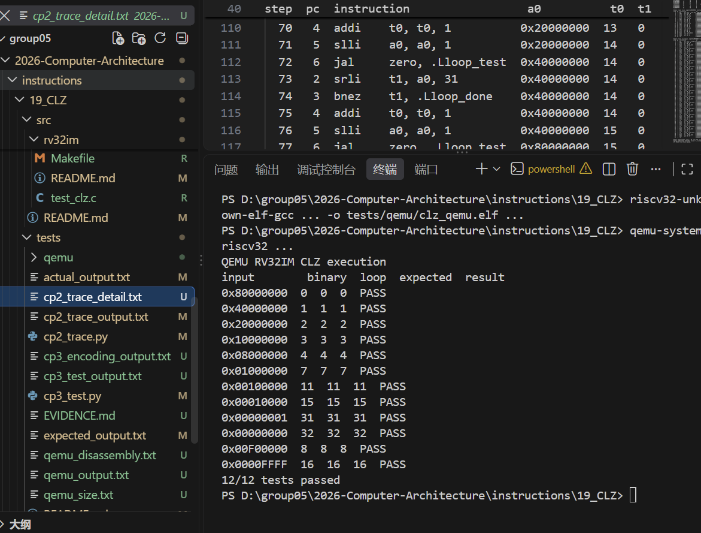
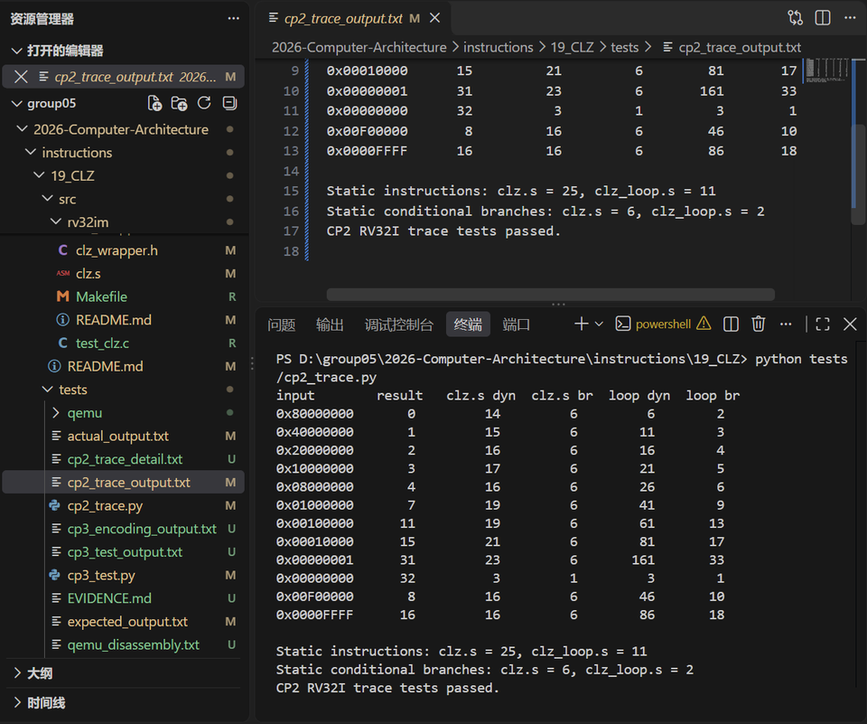

# CP2：RV32IM 實作

## 1. 本次目標

以 RV32IM 組合語言實作 CLZ，建立可重現的靜態／動態指令數與分支數，並
比較「16/8/4/2/1 分段檢查」與「逐位元迴圈」兩種寫法。

## 2. 設計內容

### 2.1 組合語言檔

| 檔案 | 角色 | 函式符號 |
|---|---|---|
| [`../src/rv32im/clz.s`](../src/rv32im/clz.s) | 主要 baseline：16/8/4/2/1 分段檢查 | `clz_rv32im` |
| [`../src/rv32im/clz_loop.s`](../src/rv32im/clz_loop.s) | 比較用 baseline：逐位元左移迴圈 | `clz_loop` |

兩者都使用 `a0` 作為輸入與回傳值，`t0` 累計前導零，`t1` 存放檢查值。
`clz.s` 只使用 `beq`、`bnez`、`addi`、`srli`、`slli`、`ret`；`clz_loop.s`
另外使用 `jal zero, label` 作為迴圈跳躍。

### 2.2 演算法

**分段檢查（`clz.s`）**：

1. `a0 == 0` 時直接回傳 32。
2. 依序檢查 16、8、4、2、1 位元區段；若區段全為 0，計數加上區段長度
   並左移。
3. 最後 `a0 = t0` 並返回。

**逐位元迴圈（`clz_loop.s`）**：

1. `a0 == 0` 時直接回傳 32。
2. 每回合檢查 bit 31；若為 0，計數加 1、左移 1 位，回到迴圈。
3. 找到第一個 1 時返回計數。

### 2.3 C wrapper / inline assembly

[`../src/rv32im/clz_wrapper.h`](../src/rv32im/clz_wrapper.h) 提供：

```c
static inline uint32_t clz_insn(uint32_t x)
{
    uint32_t rd;
    __asm__ volatile(".insn r 0x0b, 0, 0, %0, %1, %2"
                     : "=r"(rd) : "r"(x), "r"(0));
    return rd;
}
```

依課程公告，`funct3 = 000`、`funct7 = 0000000`、`rs2 = x0`。非 RISC-V
平台會 fallback 到 `clz_rv32im()`。

## 3. 結果與分析

### 3.1 執行與計數工具

**正確性驗證**：`clz.s` 與 `clz_loop.s` 由 `riscv32-unknown-elf-gcc`
14.2.0 組譯成 RV32IM 機器碼，放進 QEMU 11.1.2 的 `virt` 機器執行。
12 組測試全部通過，輸出在
[`../tests/qemu_output.txt`](../tests/qemu_output.txt)，反組譯在
[`../tests/qemu_disassembly.txt`](../tests/qemu_disassembly.txt)。



*圖：QEMU 11.1.2 執行 RV32IM baseline，兩個實作皆 12/12 通過（2026-10-28）。*

**動態指令數**：由 [`../tests/cp2_trace.py`](../tests/cp2_trace.py) 逐條
執行同一份組合語言取得。工具為 **Python 3.12.10**；每執行一條指令計 1，
條件分支不論是否跳轉都計 1。

QEMU 負責「真的執行、結果正確」，Python runner 負責「逐條計數」。兩者
都不是 cycle 量測；QEMU `virt` 沒有實作本組的 custom-0 `clz` opcode，
因此 custom instruction 沒有在 QEMU 中執行。完整說明見
[`../tests/EVIDENCE.md`](../tests/EVIDENCE.md)。

### 3.2 靜態指令數（計數方法：靜態）

只計算函式中的實際 RV32I 指令，不計 label、註解與 `.section`、`.globl`、
`.type`、`.size` 等指示詞；`ret` 以 1 條計。

| 實作 | 靜態指令數 | 靜態條件分支數 |
|---|---:|---:|
| `clz.s` 分段檢查 | 25 | 6 |
| `clz_loop.s` 逐位元迴圈 | 11 | 2 |

### 3.3 動態指令數（計數方法：動態）

| 輸入 | 結果 | `clz.s` 動態 | `clz.s` 分支 | `clz_loop.s` 動態 | `clz_loop.s` 分支 |
|---|---:|---:|---:|---:|---:|
| `0x80000000` | 0 | 14 | 6 | 6 | 2 |
| `0x40000000` | 1 | 15 | 6 | 11 | 3 |
| `0x20000000` | 2 | 16 | 6 | 16 | 4 |
| `0x10000000` | 3 | 17 | 6 | 21 | 5 |
| `0x08000000` | 4 | 16 | 6 | 26 | 6 |
| `0x01000000` | 7 | 19 | 6 | 41 | 9 |
| `0x00100000` | 11 | 19 | 6 | 61 | 13 |
| `0x00010000` | 15 | 21 | 6 | 81 | 17 |
| `0x00000001` | 31 | 23 | 6 | 161 | 33 |
| `0x00000000` | 32 | 3 | 1 | 3 | 1 |
| `0x00F00000` | 8 | 16 | 6 | 46 | 10 |
| `0x0000FFFF` | 16 | 16 | 6 | 86 | 18 |

完整輸出見 [`../tests/cp2_trace_output.txt`](../tests/cp2_trace_output.txt)；
`0x00010000` 的逐條 trace 見
[`../tests/cp2_trace_detail.txt`](../tests/cp2_trace_detail.txt)。



*圖：Python 3.12.10 的 trace runner 輸出動態指令數與條件分支數（2026-10-28）。*

### 3.4 兩種寫法的比較

- **靜態指令數**：迴圈版本較短（11 條），分段檢查較長（25 條）。
- **動態指令數**：迴圈版本隨前導零數量線性成長；分段檢查最多五個階段。
- 非零輸入時，分段檢查可寫成：

  ```text
  dynamic = 14 + 2 × S + F
  ```

  `S` 是實際左移的區段數（0–4），`F` 是最後 1-bit 是否加 1（0 或 1）。
- 逐位元迴圈在 `CLZ = L` 時：

  ```text
  dynamic = 6 + 5 × L   (L = 0..31)
  ```

  零輸入例外，為 3 條。
- 因此 `CLZ` 很小時（例如 `0x80000000`，14 vs 6）迴圈版本較少指令；
  `CLZ` 很大時（例如 `0x00000001`，23 vs 161）分段檢查明顯較好。
  `CLZ = 2` 附近兩者接近（16 vs 16）。
- **分支數**：分段檢查對非零輸入固定 6 條條件分支；迴圈版本從 2 條成長
  到 33 條。若考慮分支預測失敗成本，迴圈版本的實際 penalty 會更高，但
  本 CP 沒有量測 cycle，因此不進一步推論。

## 4. 遭遇的問題與解法

- **重複實作與符號不一致**：原本同時存在 `rv32im/clz.S` 與
  `src/rv32im/clz.s`，一份定義 `clz`、另一份定義 `clz_rv32im`，
  `test_clz.c` 連結會失敗。現在只保留 `src/rv32im/`，並統一符號為
  `clz_rv32im`。
- **動態指令數曾用手算**：手算容易漏算 `ret` 或條件分支。現在由
  `cp2_trace.py` 逐條執行，並把輸出存成檔案；表格中的數字都來自該輸出。
- **模擬器支援**：本組使用 QEMU `virt` 執行標準 RV32IM baseline，沒有
  使用 Spike/Ripes；QEMU 不支援 custom-0 `clz`，因此 custom instruction
  只驗證編碼與 golden model，不宣稱硬體執行。報告中也沒有 cycle 數據。
- **零輸入路徑**：`beq` 必須放在最前面，避免 fall-through 到位元檢查。

## 5. 白話說明

CP2 把 CP1 的 C 演算法翻成 RISC-V 組合語言。做法和 C 一樣，只是沒有
if 布林值，全部變成「比較、跳躍、位移」。我們另外寫了一個一位一位數的
版本來比較：它靜態指令比較少，但前導零很多時要跑很多圈；分段檢查則是
固定幾個階段，適合最壞情況。自訂 `clz` 指令則把整段 baseline 壓縮成
1 條指令。

### 5.1 5 Whys

1. 為什麼要用多條 RV32I 指令？因為 RV32IM 沒有 `clz` 指令。
2. 為什麼不能直接用 `clz`？因為那是 Zbb 擴充，不屬於本 CP2 的 baseline。
3. 為什麼採用 16/8/4/2/1 分段？因為每次可把未檢查範圍縮小一半左右。
4. 為什麼還要寫逐位元迴圈？因為要比較「靜態短」與「動態短」的取捨。
5. 為什麼要用 trace runner？因為逐條執行同一份組合語言，才能驗證結果
   與指令數，而不是只靠手算。

## 6. AI 使用說明

- **工具**：GitHub Copilot（VS Code）、OpenCode（AI coding agent）。
- **用途**：協助整理 RV32IM 指令流程、除錯 trace runner、產生靜態／
  動態指令數表格與寫法比較。
- **本組修改**：AI 產生的指令數由 `tests/cp2_trace.py` 重新執行確認；
  組合語言、C wrapper 與測試程式由組員逐行核對。
- **動態統計取得方式**：`tests/cp2_trace.py`（Python 3.12.10）逐條執行
  `src/rv32im/clz.s` 與 `src/rv32im/clz_loop.s`，輸出存於
  `tests/cp2_trace_output.txt`；不是手算，也不是模擬器 cycle。結果正確性
  另由 QEMU 11.1.2 執行同一份 RV32IM 機器碼驗證，輸出在
  `tests/qemu_output.txt`。
