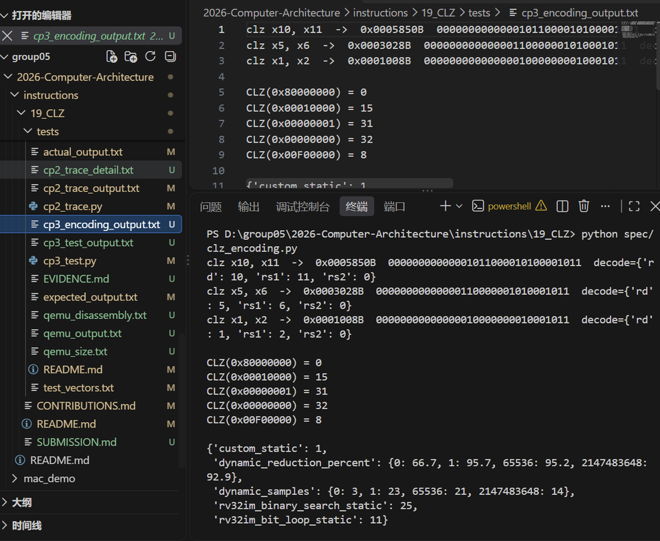
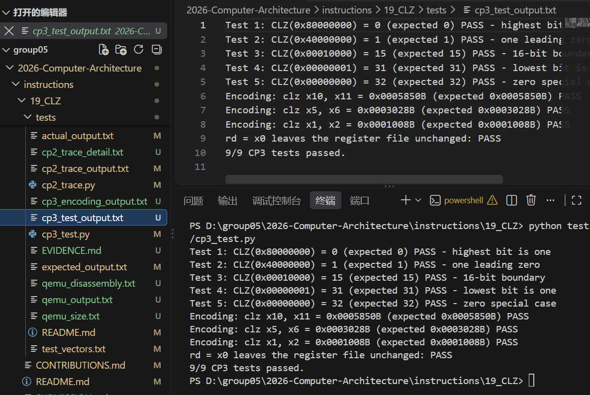

# CP3：CLZ 指令規格、編碼與指令數比較

## 1. 本次目標

定義 CLZ 自訂指令的語意與 R-type 編碼（custom-0、`funct3 = 000`、
`funct7 = 0000000`），提供 3 個含邊界值的範例，並分別以靜態與動態方法
比較 RV32IM baseline 與自訂指令的指令數。

## 2. 設計內容

### 2.1 指令語意

CLZ 是一元指令，格式為 `clz rd, rs1`：

```text
rd = CLZ(rs1)
```

`CLZ` 從 bit 31 開始計算連續的 0；等價公式為：

```text
rd = 32 − bit_length(rs1)
bit_length(0) = 0
```

`rs1 = 0` 時 `rd = 32`。輸入與輸出皆視為 32-bit 位元向量，結果範圍
`0..32`。`rs2` 不使用，固定為 `x0`。

### 2.2 虛擬碼

```text
CLZ(rs1):
    if rs1 == 0:
        return 32
    count = 0
    for i = 31 down to 0:
        if bit(rs1, i) == 1:
            return count
        count = count + 1
```

### 2.3 編碼

依課程公告，所有自訂指令使用 R-type、custom-0：

```text
31      25 24   20 19   15 14  12 11    7 6       0
+----------+-------+-------+------+-------+---------+
|  funct7  |  rs2  |  rs1  |funct3|  rd   | 0001011 |
+----------+-------+-------+------+-------+---------+
```

| 欄位 | 位元 | CLZ 的值／用途 |
|---|---|---|
| `funct7` | 31:25 | `0000000` |
| `rs2` | 24:20 | `00000`（不使用） |
| `rs1` | 19:15 | 輸入暫存器 |
| `funct3` | 14:12 | `000` |
| `rd` | 11:7 | 結果暫存器 |
| `opcode` | 6:0 | `0001011`（`0x0B`） |

機器碼計算式：

```text
word = (funct7 << 25) | (rs2 << 20) | (rs1 << 15)
     | (funct3 << 12) | (rd << 7) | opcode
```

### 2.4 三個範例

| 組合語言 | 輸入 | 預期結果 | 機器碼 |
|---|---|---:|---|
| `clz x10, x11` | `0x80000000` | 0 | `0x0005850B` |
| `clz x5, x6` | `0x00010000` | 15 | `0x0003028B` |
| `clz x1, x2` | `0x00000000` | 32 | `0x0001008B` |

`clz x10, x11` 的欄位展開：

```text
funct7  rs2   rs1   funct3 rd    opcode
0000000 00000 01011 000    01010 0001011
```

第一個範例驗證最高位為 1（結果 0）；第二個驗證 16-bit 邊界（結果 15）；
第三個是全零邊界值（結果 32）。



*圖：`spec/clz_encoding.py` 產生的三個機器碼範例、golden model 與指令數資料。*

### 2.5 對應的 RV32IM baseline

`src/rv32im/clz.s` 的 `clz_rv32im` 使用 16/8/4/2/1 分段檢查，靜態 25 條
指令、6 條條件分支。完整片段與指令數列在
[`../spec/clz_spec.md`](../spec/clz_spec.md) 的「對應的 RV32IM baseline
片段與指令數」一節。

## 3. 結果與分析

### 3.1 測試結果

在 `instructions/19_CLZ` 執行：

```text
python tests/cp3_test.py
```

實際輸出：

```text
Test 1: CLZ(0x80000000) = 0 (expected 0) PASS - highest bit is one
Test 2: CLZ(0x40000000) = 1 (expected 1) PASS - one leading zero
Test 3: CLZ(0x00010000) = 15 (expected 15) PASS - 16-bit boundary
Test 4: CLZ(0x00000001) = 31 (expected 31) PASS - lowest bit is one
Test 5: CLZ(0x00000000) = 32 (expected 32) PASS - zero special case
Encoding: clz x10, x11 = 0x0005850B (expected 0x0005850B) PASS
Encoding: clz x5, x6 = 0x0003028B (expected 0x0003028B) PASS
Encoding: clz x1, x2 = 0x0001008B (expected 0x0001008B) PASS
rd = x0 leaves the register file unchanged: PASS
9/9 CP3 tests passed.
```

測試涵蓋五組語意案例、三組編碼與一組 `rd = x0` 行為。



*圖：CP3 語意、編碼與 `rd = x0` 測試，9/9 通過（2026-10-28）。*

### 3.2 靜態指令數（計數方法：靜態）

計數對象為函式本身的組合語言，不計 label、註解與指示詞；`ret` 以 1 條計。

| 實作 | 靜態指令數 | 靜態條件分支數 |
|---|---:|---:|
| RV32IM `clz_rv32im` | 25 | 6 |
| RV32IM `clz_loop`（比較用） | 11 | 2 |
| CLZ 自訂指令 | 1 | 0 |

以分段檢查為 baseline，靜態指令數由 25 降到 1，減少 `24/25 = 96.0%`。

### 3.3 動態指令數（計數方法：動態）

計數工具：Python 3.12.10 的 `tests/cp2_trace.py`，逐條執行實際組合語言。
每執行一條指令計 1；條件分支不論是否跳轉都計 1。這不是 Spike/Ripes，
也不是 cycle 量測。RV32IM baseline 的正確性另由 QEMU 11.1.2 執行同一份
機器碼驗證（12/12），輸出在 `tests/qemu_output.txt`。

| 輸入 | 結果 | RV32IM 動態 | RV32IM 分支 | CLZ 動態 | Reduction |
|---|---:|---:|---:|---:|---:|
| `0x80000000` | 0 | 14 | 6 | 1 | 92.9% |
| `0x00010000` | 15 | 21 | 6 | 1 | 95.2% |
| `0x00000001` | 31 | 23 | 6 | 1 | 95.7% |
| `0x00000000` | 32 | 3 | 1 | 1 | 66.7% |

Reduction 定義為 `(RV32IM 動態 − 1) / RV32IM 動態`。

### 3.4 不比較 cycle

本 CP 只比較指令數，不比較 clock cycle、CPI 或 pipeline。課程目前尚未
教授 pipeline，本次作業也不要求 cycle 數，因此沒有把指令數換算成
clock 或加速比。

## 4. 遭遇的問題與解法

- **`funct3`／`funct7` 更新**：依課程公告改為 `funct3 = 000`、
  `funct7 = 0000000`。encoder、decoder、C wrapper、測試與三個機器碼
  範例都已同步更新（`clz x10, x11` 從舊值改為 `0x0005850B`）。
- **靜態與動態混用**：原本同一段文字同時出現靜態 25 條與動態 3–23 條，
  `clz_spec.md` 也混在一起。現在分成「3.2 靜態」與「3.3 動態」兩張表，
  各自標明計數方法。
- **缺少 baseline 片段**：`clz_spec.md` 原本只寫檔案路徑。現在已補上
  `clz_rv32im` 的完整組合語言片段與指令數。
- **報告重複**：原本 `CP3.md` 內有兩份 CP3 內容、夾雜學號與孤立文字。
  現在只保留一份，章節依 1–6 排列。
- **全零邊界**：`bit_length(0) = 0`，因此結果必須是 32；測試特別放入
  `0x00000000`。
- **欄位位置**：`rs1`、`rd` 容易放反；`cp3_test.py` 會把機器碼解碼，
  確認 `rd`、`rs1`、`rs2`、`funct3`、`funct7` 與 opcode。

## 5. 白話說明

CLZ 指令是在問：「這個 32 位元數字最左邊有幾個 0？」例如最高位是 1，
答案就是 0；只有最低位是 1，答案就是 31；全部是 0，規格說答案是 32。
我們把這條指令填進 R-type 的欄位表：opcode 說「這是 custom-0」，
funct3/funct7 依公告填 0，rs1 放輸入，rd 放輸出。最後用幾個容易手算的
數字和機器碼解碼，確認答案與欄位都沒有放錯。

### 5.1 5 Whys

1. 為什麼要設計 custom CLZ？因為 RV32IM baseline 需要多條位元檢查指令。
2. 為什麼使用 R-type？因為指令需要指定 `rd` 與 `rs1`，且課程統一要求
   R-type。
3. 為什麼 `rs2` 固定為 0？因為 CLZ 是一元運算，不需要第二個輸入。
4. 為什麼 `funct3`／`funct7` 都是 0？因為課程公告統一分配這兩個欄位，
   本組不能自行更改。
5. 為什麼只比較指令數、不比較 cycle？因為作業明確不要求 cycle，且
   pipeline 尚未教授。

## 6. AI 使用說明

- **工具**：GitHub Copilot（VS Code）、OpenCode（AI coding agent）。
- **用途**：協助整理 CP3 測試涵蓋範圍、檢查 CLZ 邊界值、重算 R-type
  欄位與機器碼。
- **本組修改**：AI 產生的欄位表與機器碼由 `tests/cp3_test.py` 與
  `spec/clz_encoding.py` 重新執行驗證；報告文字由組員逐段核對。
- **動態數據來源**：`tests/cp2_trace.py`（Python 3.12.10）逐條執行
  `src/rv32im/clz.s`，輸出存於 `tests/cp2_trace_output.txt`；不是手算。
